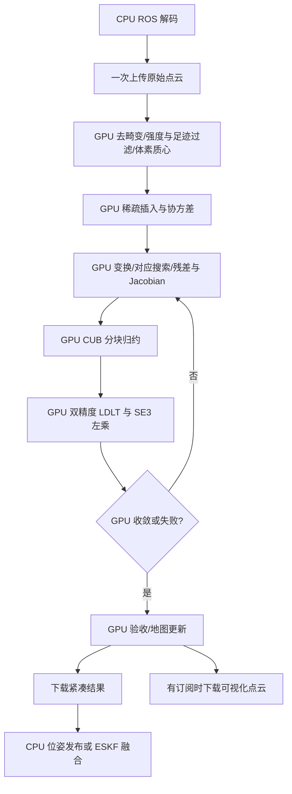

# SparsityAwareGICP Algorithm Flow

当前精简版 `GICP` 在 GPU 完成地图插入、协方差、逐点变换、对应搜索、加权残差与法方程归约；
CPU 每轮只接收 240 字节归约结果，用 Eigen LDLT 求解 6x6 系统，并执行 Sophus 左乘更新与迭代控制。
实测该混合方案比协作式全 GPU 迭代更快，因此不保留额外的设备求解器。构建及实测结果见 [README](../README.md#gicp-cuda-alignment)。

第 1、3、4、13–15 节保留旧 `SparsityAwareGICP` 的布局和实验历史，不代表当前设备端布局、配置或可执行目标。历史 Cauchy/阻尼推导属于可选拓展；当前实现取 $w=1$、$\lambda=0$。

`SparseVoxel` 现已改为直接提供设备成员函数；对象以 `new` / `std::make_unique` 分配到统一内存，
CPU 只负责资源管理和阻塞式 `insert()`。设备接口和生命周期约束见 [README](../README.md#sparsevoxel-device-api)。
当前 `insertTargetPoints()` / `align()` 已对照 CPU Eigen/Sophus 实现验证；
下述预处理、去畸变、常驻帧与可视化完整流程属于旧实现说明，不代表当前精简接口。

实现位于以下文件：

- [`GICP.h`](../include/localization/GICP/GICP.h)：配置、结果、目标插入与配准接口。
- [`GICP.cu`](../source/GICP/GICP.cu)：CUDA 对应搜索与归约、CPU 小矩阵求解和位姿更新。
- [`SparseVoxel.cuh`](../include/localization/types/SparseVoxel.cuh)：统一的主机插入与设备查询接口，无独立设备视图。
- [`SparseVoxel.cu`](../source/types/SparseVoxel.cu)：GPU 分组插入、增量协方差和近邻搜索。

## 1 数据对象

### 1.1 `VoxelKey`

`VoxelKey` 是三个整数组成的 CPU 体素坐标：

```text
(i, j, k) = floor(point / voxel_size)
```

它通过 `VoxelKeyHash` 用作 `std::unordered_map` 和 `std::unordered_set` 的 key。当前实现直接保存三个坐标，不进行位打包，因此没有 packed-key 的坐标范围或空 key 限制。

### 1.2 `SparsePoint`

`SparsePoint` 是稀疏化阶段的**中间对象**：

```cpp
struct SparsePoint
{
    Eigen::Vector3f position;
    VoxelKey key;
};
```

它只保存有限、通过最小间距和每体素容量检查的输入点。

### 1.3 `PointWithCovariance`

```cpp
struct PointWithCovariance
{
    Eigen::Vector3f position;
    Eigen::Matrix3f covariance;
    bool covariance_valid;
};
```

`covariance_valid` 表示局部邻域是否足以估计出数值可用的协方差。无效协方差不会阻止该点参与最近邻搜索，但在 GICP 权重中会触发单位阵回退。

### 1.4 `VoxelPointLayout`

`VoxelPointLayout` 保存按体素排序后的连续点数组：

```cpp
struct VoxelPointLayout
{
    std::vector<PointWithCovariance> points;
    std::vector<VoxelEntry> voxels;
    std::vector<VoxelKey> voxel_keys;
};
```

其中 `voxels[n] = {start, count}` 指向 `points` 中同一体素的连续区间：

```text
voxel n -> points[start ... start + count - 1]
```

`voxel_keys[n]` 与 `voxels[n]` 一一对应，目标缓存以该 key 到 `voxels` 下标的映射加速查询。

### 1.5 `TargetCache`

目标地图缓存保存在主机内存中：

```cpp
struct TargetCache
{
    std::unordered_set<VoxelKey, VoxelKeyHash> occupied_voxels;
    std::vector<PointWithCovariance> points;
    std::vector<VoxelEntry> voxels;
    std::unordered_map<VoxelKey, int, VoxelKeyHash> voxel_map;
};
```

- `occupied_voxels`：用于增量插入时跳过已有体素；
- `points`：目标点及其协方差；
- `voxels`：目标点的连续体素区间；
- `voxel_map`：`VoxelKey -> voxels` 下标，用于查询邻近目标体素。


## 2 总体流程




## 3 稀疏化与体素布局

### 3.1 `Preprocesser::makeSparseCloud()`

稀疏化按输入顺序遍历 PCL 点云，并对每个点执行：

1. 丢弃坐标为 `NaN` 或 `Inf` 的点；
2. 根据 `floor(position / voxel_size)` 得到体素 key；
3. 若该体素已经保留 `max(1, max_points_per_voxel)` 个点，丢弃该点；
4. 若该点与同体素已保留点的距离小于 `max(0.001 m, 0.1 * voxel_size)`，丢弃该点；
5. 否则保留为 `SparsePoint`。

最小间距仅在同一体素内检查，不会过滤跨体素边界但彼此很近的点。

### 3.2 `Preprocesser::makeVoxelPointLayout()`

保留点先按 `VoxelKey(i, j, k)` 的字典序排序；相同 key 的点维持原输入顺序。随后创建连续的 `points` 数组以及对应的 `{start, count}` 体素条目。新建的 `PointWithCovariance` 只含位置，协方差保持默认值且标记为无效，直到 `estimateCovariances()` 处理完成。


## 4 目标地图管理

### 4.1 初始化：`initializeTarget()`

目标点云经过稀疏化和体素布局后，先检查体素预算：

```text
max_target_voxels == 0
or layout.voxels.size() > max_target_voxels
    -> throw std::invalid_argument
```

通过检查后，CPU 为目标布局估计协方差，并构造 `TargetCache`。

### 4.2 增量插入：`insertTargetPoints()`

当前增量策略只接受此前未占用的完整体素，流程如下：

```text
if input empty:
    return

if no target:
    initializeTarget(input)
    return

if target voxel count already reaches max_target_voxels:
    return

sparse = makeSparseCloud(input)
remove every sparse point whose voxel already exists in occupied_voxels

new_layout = makeVoxelPointLayout(sparse)
if new_layout voxel count exceeds remaining budget:
    return

estimate covariance for new_layout
append new points and voxel entries to TargetCache
add new voxel keys to voxel_map and occupied_voxels
```

因此，该操作不会向已有体素补点，也不会替换旧点，更不会淘汰远处体素。若一批新点超出剩余体素预算，整批更新被拒绝，而不是部分插入。

新增点的协方差只使用此次 `new_layout` 中的邻居，不会把已有目标地图的点纳入该次估计；已有目标点的协方差也保持不变。


## 5 协方差估计：`estimateCovariances()`

当前 `GICP` 使用 [`SparseVoxel.cu`](../source/types/SparseVoxel.cu) 中的 CUDA 内核并行估计协方差。
初次插入和增量插入都使用同一策略；增量插入会重新估计受影响体素及相邻体素中的点。
GPU 按 key 稳定分组，每个体素由一个线程按原输入顺序筛点，不使用竞争式自旋锁。
设备哈希表保存独立分批分配的体素指针，后续插入不会移动已有点。
发生变化的体素原子标记其相邻体素，每个受影响点由一个线程独立选取最近邻并更新协方差。
主机等待插入完成并返回是否新增点，不回传体素或点数组，也不维护主机镜像。

### 5.1 邻域搜索

对点所在体素 $(i, j, k)$，枚举相邻一层的 27 个体素：

$$
dx, dy, dz \in [-1, 1]
$$

候选包含当前点本身，通过定长有序数组保留局部最近的最多 12 个点。
这仍是固定体素窗口内的局部 kNN，不是全局 kNN。
邻居不足 8 个时，保持 `covariance = I` 和 `covariance_valid = false`，沿用原有回退行为。
候选体素按坐标字典序访问，体素内按插入顺序访问；等距时保留先访问的点。

### 5.2 保留现有 Frobenius 协方差归一化

对于 $N$ 个候选邻居，先计算均值：

$$
\mu = \frac{1}{N}\sum_i p_i
$$

再计算局部样本协方差：

$$
\Sigma_{\mathrm{raw}} = \frac{1}{N - 1}\sum_i(p_i - \mu)(p_i - \mu)^T
$$

沿用迁移前代码的对角正则和逆矩阵 Frobenius 范数缩放：

$$
C = \Sigma_{\mathrm{raw}} + 10^{-6}I,\qquad
\Sigma_{\mathrm{GICP}} = C\,\|C^{-1}\|_F
$$

完成归一化后设 `covariance_valid = true`；邻居不足时保留无效单位阵。
非有限或超出体素坐标范围的输入在插入前通过异常显式拒绝。

此矩阵是 GICP 的几何权重模型，不应作为物理测量噪声协方差。
源点和目标点都使用相同归一化；当前使用最少 8、最多 12 个邻居及 0.5 m 体素，存储和运算使用 `float`。
这不是 PCL 的固定谱模型；第 15 节为此前实验记录。CUDA 迁移不切换协方差策略，
回归测试直接对照迁移前代码的 CPU 公式。


## 6 对应搜索：`SparseVoxel::nearestNeighbor()`

配准内核直接读取常驻源点、目标地图和设备端位姿，不调用会回传结果的主机 `nearestNeighborBatch()`。每个源点在 GPU 执行：

1. 用当前设备端双精度 $(R,t)$ 将源点变换到目标坐标系；
2. 找到该位置所在体素；
3. 先搜索当前体素，尽早收紧最近距离；
4. 枚举其余相邻一层体素，用包围盒距离下界剪枝后再查询哈希表；
5. 在保留体素中选择距离平方最小的目标点。等距时仍按原来的体素字典序和体素内插入顺序选择。

对包围盒 $[b_{\min}, b_{\max}]$，距离下界为：

$$
d_{\mathrm{box}}^2(q) =
\sum_{a\in\{x,y,z\}}\max(b_{\min,a}-q_a,0,q_a-b_{\max,a})^2
$$

只有下界严格超过当前半径并计入浮点裕量后才剪枝。
查询窗口仍是固定的 27 个体素，剪枝不把该接口变为全局最近邻搜索。

仅当距离平方严格小于

$$
\text{max\_correspondence\_distance}^2
$$

时才建立对应。未找到对应时返回的 `Neighbor::point = nullptr`。

`max_correspondence_distance` 只影响欧氏距离阈值；它不会扩大固定为一层相邻体素的查询范围。


## 7 GICP 线性系统：设备端构建与归约

每个 GPU 线程计算有效对应的残差、Jacobian 和加权贡献。Hessian 只保存 21 个上三角元素，
与 6 个梯度元素、残差平方和及整数计数一起经 CUB 分块归约。第二个内核完成最终归约和求解，不回传法方程。

### 7.1 残差与协方差

设源点、目标点和当前变换分别为 $p_s$、$p_t$、$T = (R, t)$：

$$
r = T p_s - p_t
$$

当前代码的协方差回退规则是：

$$
C =
\begin{cases}
C_t + R C_s R^T, & C_s \text{ 有效且 } C_t \text{ 有效}\\
I + R C_s R^T, & C_s \text{ 有效且 } C_t \text{ 无效}\\
I, & C_s \text{ 无效}
\end{cases}
$$

因此，目标协方差只有在源协方差有效时才会参与当前实现的 GICP 约束。精度矩阵为：

$$
W = C^{-1}
$$

若 `W.allFinite()` 为假，该对应不参与后续求解。

### 7.2 Cauchy 鲁棒权重

马氏误差为：

$$
e = r^T W r
$$

当 `cauchy_kernel_scale = s > 0` 时，权重为：

$$
w = \frac{1}{1 + e / s^2}
$$

当 $s \leq 0$ 时，鲁棒核关闭，$w = 1$。

### 7.3 左扰动 Jacobian

内部位姿 `source_to_target` 是 `Sophus::SE3f`，采用左乘增量：

$$
T \leftarrow \exp(\delta)T
$$

其中：

$$
\delta =
\begin{bmatrix}
\rho_x & \rho_y & \rho_z & \omega_x & \omega_y & \omega_z
\end{bmatrix}^T
$$

前三维是平移增量，后三维是旋转向量。令 $q = T p_s$，Jacobian 为：

$$
J = \begin{bmatrix}I & -[q]_\times\end{bmatrix}
$$

其中：

$$
[q]_\times =
\begin{bmatrix}
0 & -q_z & q_y \\
q_z & 0 & -q_x \\
-q_y & q_x & 0
\end{bmatrix}
$$

代码使用 `Sophus::SO3f::hat(transformed_position)` 构造该反对称矩阵。

每个有效对应的贡献为：

$$
H_i = J^T w W J
$$

$$
g_i = J^T w W r
$$

并在 GPU 中以双精度归约（当前 $w=1$）：

$$
H = \sum_i H_i, \qquad g = \sum_i g_i
$$

`num_correspondences` 统计实际进入该累加的约束数，而不仅是最近邻命中的数量。


## 8 求解、更新与收敛

若没有有效约束，或未加权欧氏残差平方和非有限，设备端停止本轮数值工作。当前不增加阻尼，求解：

$$
H\delta=-g
$$

GPU 使用固定大小、带对角主元交换的双精度 LDLT；零主元方向沿用 Eigen LDLT 的处理方式。
分解或求解失败则停止迭代；非有限位姿更新显式报错。成功后在设备端计算指数映射和左乘更新：

```cpp
T_next = exp(delta) * T;
```

旋转采用 Rodrigues 公式，平移采用 SO(3) 左 Jacobian；小角度使用 Taylor 展开。
主机只提交固定预算的内核批次；设备标志使收敛后的批次不再执行数值工作，无逐轮主机轮询。

若同时满足：

$$
\|\rho\| < \text{convergence\_translation}
$$

和：

$$
\|\omega\| < \text{convergence\_rotation}
$$

则 `converged = true` 并停止迭代。


## 9 `align()` 调用流程

```text
if source cloud empty:
    throw std::invalid_argument

upload source once
enqueue GPU source insertion/covariances
initialize device pose and counts
enqueue at most max_iterations pairs of linearization and solve kernels
    device flags skip work after failure/convergence
enqueue GPU convergence fallback and acceptance
download compact result and synchronize once

empty target or zero iterations:
    preserve initial_guess, converged=false
```

最后的宽松回退意味着 `converged` 不严格等价于“增量已低于阈值”：只要至少完成一次成功更新且 `fitness_score` 有限，结果也会标记为已收敛。

`fitness_score` 计算为最近一次构建法方程时有效约束的未加权欧氏残差平方均值：
$$
\text{fitness} = \frac{1}{N}\sum_i \|r_i\|^2
$$

它不是 RMSE、不是马氏误差，也不是 Cauchy 加权代价。该统计发生在本轮位姿更新之前，不会在最终更新后的位姿上重新评估。


## 10 输出结果与调用方验收

`GICP::Result` 包含：

- `converged`：是否满足严格阈值，或触发成功迭代后的宽松回退；
- `iterations`：成功完成位姿更新的次数；
- `num_source_points`：稀疏化后的源点数；
- `num_target_points`：当前缓存的目标点数；
- `num_invalid_points`：预处理丢弃的非有限输入点数；
- `num_correspondences`：最近一次构建法方程时的有效约束数；
- `fitness_score`：最近一次构建法方程时的平均欧氏残差平方；
- `transform`：从源点坐标系到目标地图坐标系的估计变换。

LO 节点使用 `processFrame()`。位姿在收敛且对应数足够时更新；地图更新额外要求 fitness 达标，保留原有调用方顺序：

```text
result.converged
result.num_correspondences >= config.min_correspondences
map update additionally requires:
    result.fitness_score <= config.max_fitness_score
```


## 11 GPU 常驻与同步边界

排序、前缀和和压缩计数均使用设备端 CUB；缓冲与哈希表采用流有序分配并复用容量。
常态 LO 帧在没有可视化订阅时只有一次原始点云上传、一次紧凑结果下载和一次结果边界同步。
存在订阅时，扫描和地图下载合并到该边界；不维护每帧 CPU 点云地图。

LIO 的 IMU 轨迹积分及 ESKF 融合留在 CPU，逐点插值、去畸变和过滤在 GPU。
融合后的位姿通过小参数传回设备，地图更新复用已上传的扫描并异步排队。
融合后如需发布点云，`downloadPrepared()` 是额外的显式输出边界。
地图扩容、显式主机查询、对象复制和销毁仍可能同步；不宣称整套系统完全没有同步。


## 12 边界与后续改进方向

- `voxel_size` 同时影响稀疏化、协方差邻域和对应搜索的物理尺度，当前三个尺度尚未解耦。
- 对应搜索只查询一层相邻体素；单独增大 `max_correspondence_distance` 可能仍会漏掉更远体素中的候选。
- 已有体素可继续补点，直到容量或最小间距门限；旧点协方差随邻近插入更新。
- 地图按需扩容，未增加空间裁剪、淘汰或自适应密度策略；设备内存不足会显式报错。
- 有效协方差的回退规则目前以源点协方差有效性为分支；若希望任一有效协方差均参与约束，需要调整该逻辑。
- 大面积平面或平行结构仍可能导致某些自由度约束不足；更可靠的初始位姿或运动先验能降低局部最优和错误对应风险。

轮速或其他里程计最直接的融合方式是提供更好的 `initial_guess`。若需将先验直接加入优化，应在 GPU 归约结果上加入相应先验项，再复用同一个设备端 $6 \times 6$ LDLT 流程。

## 13 历史 GICP 与 PCL 对比

以下为已移除旧测试目标的历史实验命令，不是当前 CUDA 验证入口。
当前回归与 Nsight 复现步骤见 [README](../README.md)。

```bash
source /opt/ros/jazzy/setup.bash
cmake -S packages/localization -B build/localization -DCMAKE_BUILD_TYPE=Release -DBUILD_TESTING=ON
cmake --build build/localization --target gicp_benchmark -j2
ctest --test-dir build/localization -R '^gicp_benchmark_smoke$' --output-on-failure
build/localization/gicp_benchmark --repeats 5 --threads 8 --csv /tmp/gicp_benchmark.csv
```

测试使用独立采样的合成多曲面点云，包含平面、起伏面和变半径圆柱面，不是把同一批点简单变换后配准。
源到目标的真实位姿固定为平移 `(0.18, -0.08, 0.04) m` 和 Z/Y/X 欧拉角
`(3, -1.5, 1) deg`，初值统一为单位变换。测试覆盖 3k/12k/40k 点、
0/5/20 mm 每轴高斯噪声和 100%/70%/40% 源点重叠率。
部分重叠由沿 X 轴裁剪观测范围构造；重叠掩码取自无噪声几何，而非算法返回的对应点。
每组先预热一次，再使用相同的一组固定种子重复测试；两种算法的执行顺序轮换。

对比包含两种输入：

- `raw`：相同原始点云，保留自写 GICP 内部稀疏化、PCL 使用全部输入点的实际 API 行为。
- `matched_sparse`：先通过当前 `SparseVoxel` 提取相同稀疏点集，再分别传给两个算法；
  程序检查自写 GICP 没有再次减少点数。共享采样不计时，因此该模式仅用于分离采样数量的影响，
  不代表从原始点云开始的端到端耗时。

自写版本分别使用 TBB 1 线程和 `--threads` 指定的线程预算；PCL 1.14 的该实现为串行。
两者最大对应距离均为 0.5 m、最多 100 次外层迭代，停止阈值数值均为 `1e-4`；
两者阈值定义不同，不能认为停止条件完全等价。
PCL 使用默认 Newton 优化器，协方差邻居数从 `SparseVoxel::MAX_COVARIANCE_NEIGHBORS`
读取，当前为 12（PCL 默认值为 20）。两者都使用 `(1, 1, 0.001)` 谱归一化，
但局部邻域、数值精度和优化器仍不同。

计时分为 `target_ms`（目标索引和协方差构建）与 `align_ms`（源点预处理和配准），
`total_ms` 为两者之和。PCL 的目标 KD-tree 和协方差通过其自身实现预先构建；
冒烟测试校验这与普通 `align()` 得到相同变换。每次测试重新构建目标，避免缓存状态混淆计时。
冒烟测试还校验平面和带噪声邻域的协方差与 PCL 一致、固定特征值和正定性，
以及邻居不足时的回退和增量插入后的重新估计。
PCL 的输出点云生成计入 `align_ms`，自写 API 只输出位姿。
数据生成、共享采样和误差评估不计时。

CSV 逐次保存输入/实际点数、迭代次数、耗时、返回的收敛标志和统一精度指标：

- `translation_mm`、`rotation_deg`：最终位姿相对已知真值的误差。
- `reference_rmse_mm`：在原始源点的真实重叠区域，最终变换点到其无噪声生成位置的 RMSE。
- `nn_rmse_mm`：同一区域内，变换后的原始源点到原始目标点云的最近邻 RMSE。
- `oracle_rmse_mm`：使用真实变换时的源点 RMSE，作为输入噪声参考。
- `success`：平移误差小于 20 mm **且**旋转误差小于 0.2 deg，不依赖算法自己的 `converged`。

不要直接比较两者各自的 `fitness_score`：对应集合、采样数量和评估位姿可能不同。
合成测试不能代替真实雷达点云、运动畸变和实际初值分布下的评估。

## 14 搜索正确性与微基准

[`tests/sparse_voxel_search.cpp`](../tests/sparse_voxel_search.cpp) 将搜索结果与同一 27 体素范围内
的暴力搜索比较，覆盖负坐标、体素面及其相邻浮点值、距离门限、等距点、空地图、
不同 k、增量插入、清空重建和较大坐标，并在 1/8 线程下检查共享邻域协方差的一致性。
1-NN 保留原有等距优先级；kNN 保证最近距离集合不变，边界等距点的具体集合没有唯一性约定。

```bash
cmake --build build/localization --target sparse_voxel_search gicp_benchmark -j2
ctest --test-dir build/localization -R '^(sparse_voxel_search|gicp_benchmark_smoke)$' --output-on-failure
build/localization/sparse_voxel_search --benchmark
```

微基准固定单线程，使用相同保留点集及体素分组查询顺序，对各组预热一次后取 7 轮中位数。
`insert_ms` 包括稀疏索引和协方差构建；`*_us` 只包含单次搜索，不含索引构建。
PCL 的结果缓冲区在查询间复用。对比前后应保持相同 k、输入和编译选项；
局部体素 kNN 与 PCL 全局 kNN 的搜索定义仍不同，正确性以局部暴力搜索对照为准。

## 15 FAR-LIO 协方差公式实验

2026-10-29 对 FAR-LIO 论文式 (1) 做了单因素实验：

$$
C=\Sigma_{\mathrm{raw}}+10^{-3}I,\qquad
\Sigma_{\mathrm{FAR}}=
\left(\frac{C^{-1}}{\|C^{-1}\|_F}\right)^{-1}
=C\,\|C^{-1}\|_F
$$

实验用带检查的 `LDLT` 求解精度矩阵，不需要 SVD 或第二次求逆。
正定性、单位精度 Frobenius 范数、独立双精度公式和增量更新测试均通过。
只替换协方差公式，保持当前 8/12 邻居参数、体素搜索、采样、优化器和初值不变。
每场景使用相同的 10 个种子；所有点数与 PCL 对照结果不变。

原始输入模式下，平移误差中位数（mm）为：

| 场景 | PCL 式协方差 | FAR-LIO 公式 | 成功次数变化 |
|---|---:|---:|---:|
| 12k 点、5 mm 噪声 | 0.939 | 2.247 | 10/10 → 10/10 |
| 70% 重叠 | 3.396 | 142.188 | 10/10 → 0/10 |
| 40% 重叠 | 5.723 | 273.974 | 10/10 → 0/10 |

成功标准为平移误差小于 20 mm 且旋转误差小于 0.2 deg。
此次仅移植公式，没有复现论文的 k=10、4 m 体素、自适应门限和 Cauchy 鲁棒核，
不能据此判断完整 FAR-LIO 系统的优劣。发现本地部分重叠场景退化后，按用户选择恢复 PCL 策略；
FAR-LIO 公式不作为当前默认实现，实验补丁与逐次数据单独保留。
